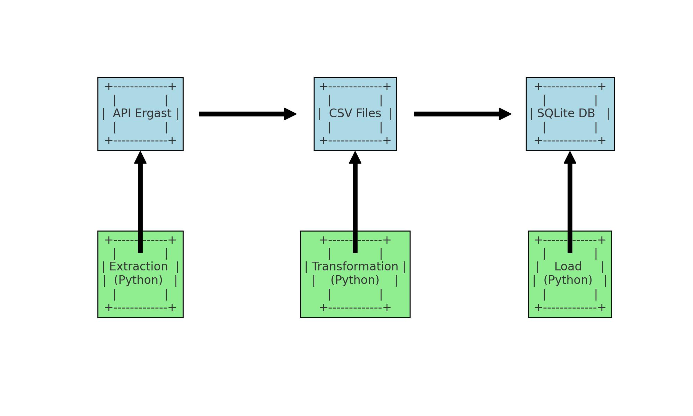

# Fórmula 1 | Pipeline de dados históricos

Extração, integração e armazenamento de resultados de corridas e classificações de Fórmula 1.

**Dados e integrações de apoio** · Pipeline ETL

[← Data Science, IA e Automações · Thiago Oliveira](https://github.com/thiagoramos20042/thiagoramos20042) · [Catálogo de projetos](https://github.com/thiagoramos20042/thiagoramos20042/blob/main/PROJETOS.md)

## Objetivo

Organizar tabelas de corridas, pilotos e construtores em uma base integrada para análise histórica.

## O que você encontra

- Extração de resultados e classificações de pilotos/construtores.
- Junções entre as tabelas em um CSV consolidado.
- Carga do conjunto integrado em f1_data.db.

## Tecnologias

Python · requests · pandas · SQLite · CSV

## Arquivos principais

| Arquivo | Conteúdo |
| --- | --- |
| [extract.py](extract.py) | Extração dos dados por API. |
| [transforme.py](transforme.py) | Integração dos arquivos CSV. |
| [load.py](load.py) | Carga no SQLite. |
| [combined_f1_data.csv](combined_f1_data.csv) | Snapshot do conjunto consolidado. |
| [f1_data.db](f1_data.db) | Snapshot do banco gerado. |

## Como explorar

Os CSVs e o banco presentes no repositório permitem explorar o resultado já gerado. Para refazer transformação e carga a partir desses CSVs:

```bash
python -m pip install pandas requests
python transforme.py
python load.py
```

A etapa de extração está em extract.py e usa o endpoint configurado no próprio script.

## Visualização



## Contexto do projeto

A carga escreve em f1_data.db. Para preservar o snapshot existente, trabalhe em uma cópia do repositório ao reproduzir o pipeline.

---

Integra o [portfólio de Thiago Oliveira](https://github.com/thiagoramos20042).
